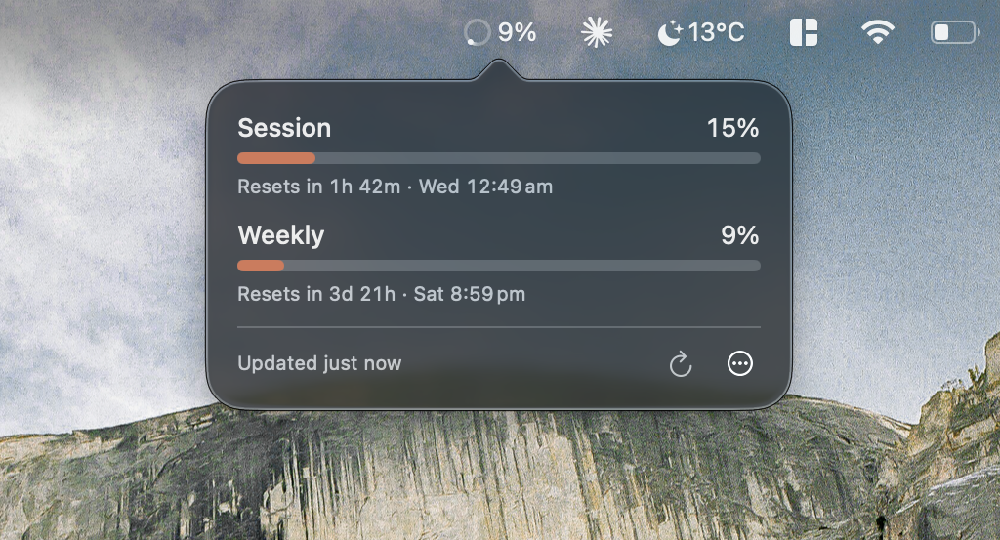

# Benched

A macOS menu bar app to show Claude subscription usage limits (session and
weekly) with a countdown to each reset. Not affiliated with Anthropic.

## How it works

Benched runs Claude Code's `/usage` command in the background
(`claude -p /usage`) and reads the report it returns. `/usage` is a local
command, so refreshing makes no model calls and uses none of your limits.

## Requirements

- macOS 26 or later
- Claude Code logged in with a Claude subscription
  (`claude auth login --claudeai`). API keys, tokens from `claude setup-token`
  and usage-based billing don't report subscription limits.

## Building from source

Open `Benched.xcodeproj` in Xcode 26 and press Run. `./check --fast` formats
the code and runs the unit and snapshot tests. `./check` adds the UI tests,
which take over the keyboard and mouse while they run.

Benched finds `claude` in the usual install locations, or by asking your login
shell. If yours is somewhere else, use "Choose claude…" in the ⋯ menu.

## Privacy

Benched makes no network requests of its own and has no telemetry. Each
refresh just runs `/usage` with your installed `claude`.

## Troubleshooting

- Benched doesn't read your shell profile, so a `CLAUDE_CONFIG_DIR` or proxy
  set in `~/.zshrc` doesn't reach `claude`, and it can look logged out or
  offline. Set it with `launchctl setenv`, then quit and reopen Benched.
- Logs: `/usr/bin/log stream --predicate 'subsystem == "com.jdamcd.benched"' --info`

## Removing it

Quit Benched from the ⋯ menu, delete the app, then delete
`~/Library/Application Support/com.jdamcd.benched/` and run
`defaults delete com.jdamcd.benched`.
